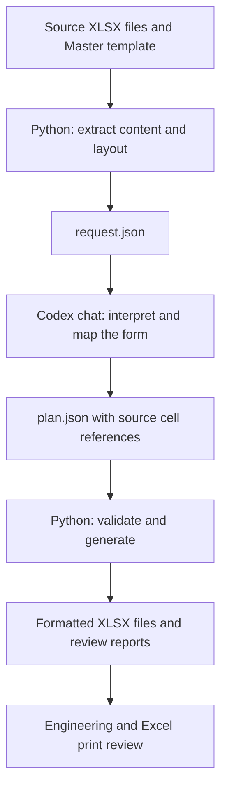

# GCME Formatter

**A Python and Codex workflow for standardizing engineering Excel forms with different layouts.**

The project combines AI-assisted form interpretation with repeatable Python workbook
generation. Codex identifies fields and table structures; Python validates the mapping,
copies a shared Master Header, and builds the output workbook.

The default workflow uses Codex chat as the planner. **No separate AI API key is required.**
Python does not connect to a Codex conversation automatically: a person starts the
chat handoff and reviews the generated forms.

## The problem

Engineering inspection forms often contain the same kinds of information in different
places: instrument identifiers, inspection items, calibration readings, remarks, and
signatures. Merged cells, wide tables, duplicate helper sheets, and inconsistent naming
make a single fixed cell-to-cell conversion script insufficient.

This project separates the work into two parts:

| Responsibility | Handled by |
| --- | --- |
| Interpret unfamiliar layouts and distinguish duplicate representations | Codex chat |
| Decide which source fields belong in the Master Header or Body | Codex chat, with human review |
| Extract cells and layout metadata, validate references, and generate workbooks | Python |
| Confirm engineering meaning, writing space, and printed layout | Human review in Excel |

## Workflow



The handoff uses local files. Workbook text is treated as data, rather than instructions
to the agent. The mapping plan describes the output; it does not contain executable code.

## Features

- **Variable form layouts:** each workbook can have its own mapping and Body sections.
- **Shared formatting:** copies Master Header cells, merged ranges, styles, and row heights.
- **Traceable mappings:** plans reference source cell IDs instead of relying on generated prose alone.
- **Source coverage checks:** every extracted nonempty cell must be represented or explicitly excluded with a reason.
- **Header protection:** rejects mappings that overwrite populated Master labels.
- **Change detection:** source, Master, selected sheets, and settings are fingerprinted; stale plans are rejected.
- **Reusable plans:** unchanged requests can use saved plans without another AI interpretation.
- **Batch handling:** per-file reports, isolated failures, and protection against overwriting existing outputs.
- **Print setup:** A4, configurable margins, a defined print area, and fit-to-one-page settings.

Coverage validation helps detect missing references. It does **not** prove that a mapping
preserves engineering meaning or that an exclusion is appropriate.

## Quick start

### 1. Install

Requirements: Python 3.11+, Git, and access to Codex with the cloned project as its
workspace. VS Code is optional. The commands below use Windows PowerShell.

```powershell
git clone https://github.com/o0muay72670o/gcme_formatter.git
cd gcme_formatter
py -3 -m venv .venv
.\.venv\Scripts\python.exe -m pip install -r requirements.txt
```

In VS Code, choose `.venv\Scripts\python.exe` through **Python: Select Interpreter**.

### 2. Add your files

```text
input/
    inspection-form.xlsx
templates/
    Master File.xlsx
```

Source workbooks and the Master template are **not included in the repository**.
Supply your own files, then adjust [config.json](config.json) to match the Master.
The default configuration expects a sheet named `Sheet1`, Header rows 1–10 through
column AP, and a blank title cell at P4.

### 3. Prepare requests

```powershell
.\.venv\Scripts\python.exe main.py prepare input
```

This extracts local workbook data into `jobs/<name>-<hash>/request.json`.
It makes no AI or network request. Folder preparation reads `.xlsx` files directly
inside the specified folder; it does not recursively process subfolders.

### 4. Ask Codex to create the plans

Open a Codex chat attached to this project and use a prompt such as:

> Process the prepared requests in jobs using the Master Header. Read AGENTS.md,
> create a plan.json beside each request, validate the source references, and apply
> the plans. Use this chat for analysis; do not use an API. Preserve engineering
> wording and blank entry fields, and flag uncertain mappings for review.

Codex can also run preparation when asked to process the files in `input/`.
[AGENTS.md](AGENTS.md) documents the project workflow for the agent.

### 5. Apply and review

If Codex has written the plans but has not applied them:

```powershell
.\.venv\Scripts\python.exe main.py apply jobs
```

Workbooks appear in `output/`, with individual reports in `output/reports/`.
Open them in Excel and check field meaning, exclusions, response boxes, signatures,
and Print Preview before accepting the forms.

The included VS Code launch configurations also offer **Prepare folder for Codex
chat** and **Apply Codex chat plans**. Ask Codex to create the plans between those steps.

## Useful commands

```powershell
# Inspect a workbook locally.
.\.venv\Scripts\python.exe main.py inspect "input/inspection-form.xlsx"

# Select actual form sheets when the workbook also contains helper sheets.
.\.venv\Scripts\python.exe main.py prepare "input/inspection-form.xlsx" --sheets "Page 1" "Page 2"

# Apply a single prepared request.
.\.venv\Scripts\python.exe main.py apply "jobs/your-job/request.json"

# Write a new run without replacing existing output files.
.\.venv\Scripts\python.exe main.py apply jobs --output output/run2

# Run tests using generated workbook fixtures.
.\.venv\Scripts\python.exe -m unittest discover -s tests -v
```

Missing plans report `waiting_for_chat`. Invalid plans fail with a reason. Re-running
preparation keeps existing plans, but changed inputs or settings require a matching new
request. Keep the jobs folder focused on the current batch, or apply individual requests.

`batch input` and `plan FILE` also prepare chat requests by default. An optional API
planner is available only through explicit `--api` mode and separate credentials;
it is not required for the workflow described here.

## Default output settings

| Setting | Default |
| --- | --- |
| Master Header | Rows 1–10, columns A–AP |
| Form title | Blank Master cell P4 |
| Target column width | 0.44 cm |
| Paper | A4 portrait, fit to one page wide and tall |
| Left / right margins | 1.6 / 0.6 cm |
| Top / bottom margins | 1.9 / 1.9 cm |
| Header / footer margins | 0.8 / 0.8 cm |

The writer renames the active source sheet to `Old` with collision handling and adds
a form sheet based on the filename. Names are limited to Excel's 31-character maximum.
Original input files are not overwritten. Source sheets remain in the output copy,
subject to the Excel feature-preservation limits below.

## Development examples

The following batches were processed locally during development. Engineering workbooks,
templates, generated plans, and reports are kept outside Git.

| Example | Local result |
| --- | --- |
| Structural steel and building inspection forms | 22 forms generated; 1 document-status register preserved unchanged |
| Instrumentation forms, ECM-05-013 Spin 1 | 26 legacy XLS forms converted to working XLSX copies and reformatted; 1 register preserved |
| Construction Punch List | Duplicate Body identification fields removed while retaining completion dates and signatures |

The resulting forms were checked in Microsoft Excel for single-page A4 printing.
Those runs included Codex review and additional local Excel conversion/verification
steps. **They are assisted-workflow examples, not evidence that the published CLI
automatically converts XLS files or verifies every printed page.** Wide tables were
sometimes split into linked sections with fewer blank record rows; review capacity
before using a generated form for multiple instruments or punch items.

No API calls were used for these chat-assisted runs. They still used Codex chat
capacity; exact chat token consumption and cost were not available to the workflow.

## Limitations

- **Human review remains necessary.** Source coverage is not a substitute for engineering approval.
- **Native input support is XLSX.** Legacy XLS files require conversion first. XLSM and protected workbooks are not supported by the documented CLI.
- **Print settings are not print verification.** The CLI estimates shrinkage. Actual page count, legibility, and physical column widths need checking in Excel.
- **Complex Excel objects need care.** Images, handwritten marks, drawings, and controls are not interpreted. Floating Master logos are not copied; `openpyxl` can lose unsupported features in output copies.
- **Formula handling is limited.** Master Header formulas are rejected. Source-sheet renames with dependent formulas or named ranges can require native Excel handling. Body formulas are written as literal text rather than recalculated.
- **This is a chat-assisted process.** Python does not independently start or control Codex sessions. Unfamiliar layouts still need AI analysis and review.

## Repository structure

```text
excel_forms/
    extract.py          # Source cells, merges, and Master Header context
    planner.py          # Plan schema, validation, fingerprints, optional API planner
    chat_workflow.py    # Local prepare/apply handoff
    writer.py           # Deterministic workbook generation
    cli.py              # Command-line interface
tests/                  # Synthetic workbook tests
.vscode/                # Editor and debugger configuration
AGENTS.md               # Instructions for Codex project chats
config.json             # Template and layout settings
main.py                 # Entry point
```

Input workbooks, templates, jobs, generated outputs, `.env`, and `.venv` are excluded
by [.gitignore](.gitignore). The repository shares the implementation and workflow;
provide your own engineering documents when trying it.
